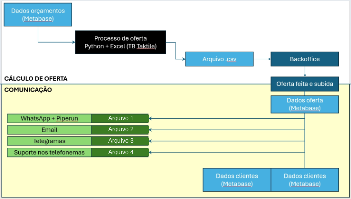

# 📣 Cilia/Taktile — Criação e Envio de Ofertas por Canais

Processo que transforma a base de projeção orçamentária em **ofertas de crédito** cadastradas no sistema Cilia e gera, a partir de um único fluxo, os arquivos para **quatro canais de comunicação** com os clientes.

> 🔗 Este processo é a continuação da **[Análise de Crédito Cilia](https://github.com/anajuliapf/cilia-analise-credito)**, onde as oficinas elegíveis são identificadas e qualificadas antes de receberem a oferta.

📄 Documentação:
- [Análise de Crédito Cilia (GitHub)](https://github.com/anajuliapf/cilia-analise-credito) — etapa anterior: qualificação das oficinas
- [Processo de oferta Cilia/Taktile](https://app.notion.com/p/Processo-de-oferta-Cilia-Taktile-1b22d5f40ff7807c87d7e03705ca9033) — visão geral do processo
- [Aplicação com Apps Script](https://app.notion.com/p/Aplica-o-com-Apps-Script-1b32d5f40ff780f2bc0fffef9697bf64) — código JavaScript da aplicação
- [Script Telegramas](https://app.notion.com/p/Script-Telegramas-1882d5f40ff78027922df9996c9fba49) — geração dos telegramas via Correios

## 🔄 Fluxo do processo



### Cálculo de oferta

1. **Extração** do arquivo principal *budget projection* no Metabase.
2. **Tratamentos** em Python + Excel, como detalhado na [Análise de Crédito Cilia](https://github.com/anajuliapf/cilia-analise-credito), usando a tabela de referência da Taktile.
3. Geração do **CSV de ofertas**, que precisa ser salvo na pasta de subida do backoffice sempre que for inserido no sistema.
4. **Upload no backoffice do Cilia Crédito**, que registra as ofertas dos clientes no sistema.

### Comunicação

A partir das ofertas subidas, surgem novos dados no Metabase. Eles geram os arquivos que o time de negócios envia para as áreas de contato. Cada canal recebe seu próprio arquivo:

| Canal | Arquivo |
|---|---|
| 📱 WhatsApp + 🧩 PipeRun | Arquivo 1: contato direto e registro no CRM |
| ✉️ E-mail | Arquivo 2: envio da oferta por e-mail |
| 📮 Telegramas | Arquivo 3: envio formal via Correios ([RPA abaixo](#-rpa-de-telegramas)) |
| ☎️ Suporte nos telefonemas | Arquivo 4: apoio ao time nas ligações |

## ⚙️ Aplicação com Apps Script

[`apps-script/AtualizarTabela.gs`](apps-script/AtualizarTabela.gs) traz cada tabela do Metabase para o Google Sheets:

1. Faz login na API do Metabase e obtém o token de sessão.
2. Executa a pergunta salva (card) e recebe o resultado em JSON.
3. Limpa a aba de destino e grava os dados com as colunas na ordem definida.
4. Registra a data e a hora da última atualização na célula `M1`.

As credenciais ficam nas **Propriedades do script** do Apps Script, fora do código.

## 📮 RPA de Telegramas

[`telegramas/envio_telegramas.py`](telegramas/envio_telegramas.py) automatiza o envio de telegramas em massa pelo sistema dos Correios.

| Antes | Depois |
|---|---|
| ~9 horas de preenchimento manual | **~1h30** com o robô |

Ganho de produtividade sem ampliar a equipe.

Para cada oficina da planilha, o robô (Selenium):

1. Faz login no sistema dos Correios.
2. Preenche o **remetente** e o CNPJ de cobrança.
3. Preenche o **destinatário**: nome do sócio, CEP, número, complemento e CNPJ da oficina.
4. Monta a **mensagem personalizada** com o nome do sócio e o valor do crédito pré-aprovado.
5. Aceita os termos, envia e **paga com o cartão cadastrado**.
6. Ao final, abre o **relatório analítico** de todos os envios.

Credenciais e CVV vêm de variáveis de ambiente, fora do código.

## 📂 Estrutura

```
apps-script/      # Aplicação em Google Apps Script (Metabase → Google Sheets)
telegramas/       # RPA de envio de telegramas (Correios)
```

## 🧰 Ferramentas

Python · Google Apps Script (JavaScript) · Metabase · OneDrive · PipeRun · Taktile

> ⚠️ Dados de clientes e credenciais **não fazem parte deste repositório**.
